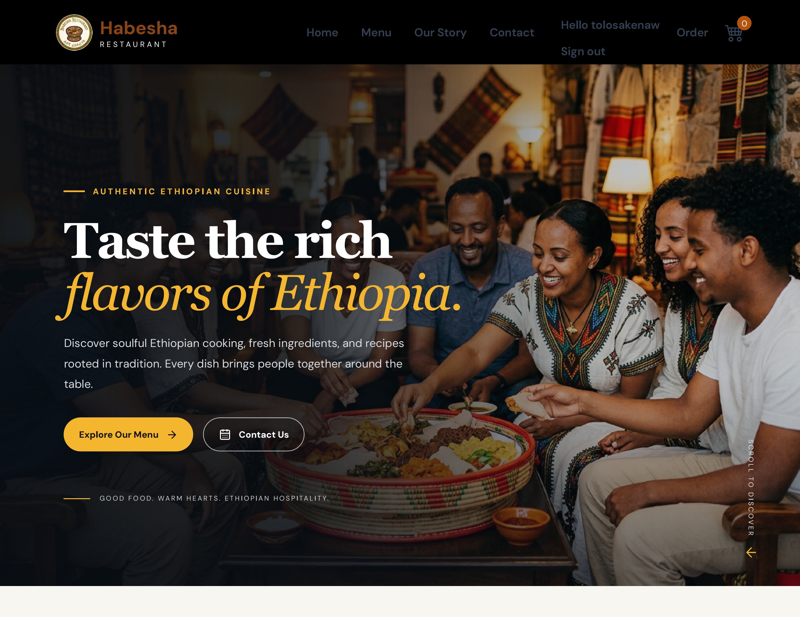
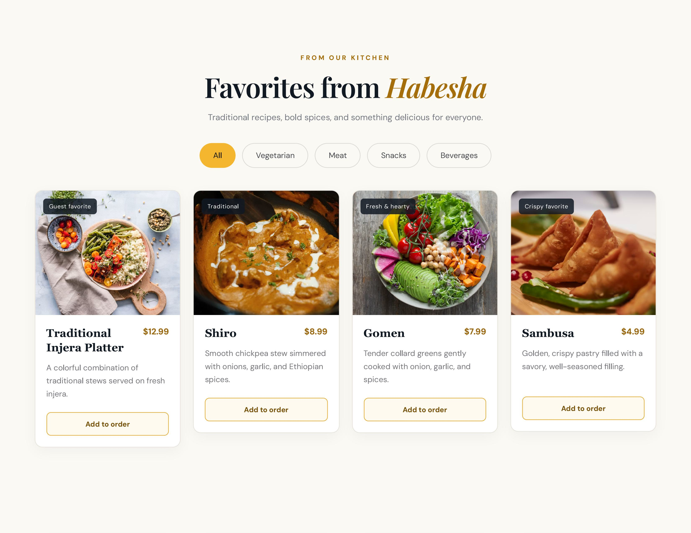
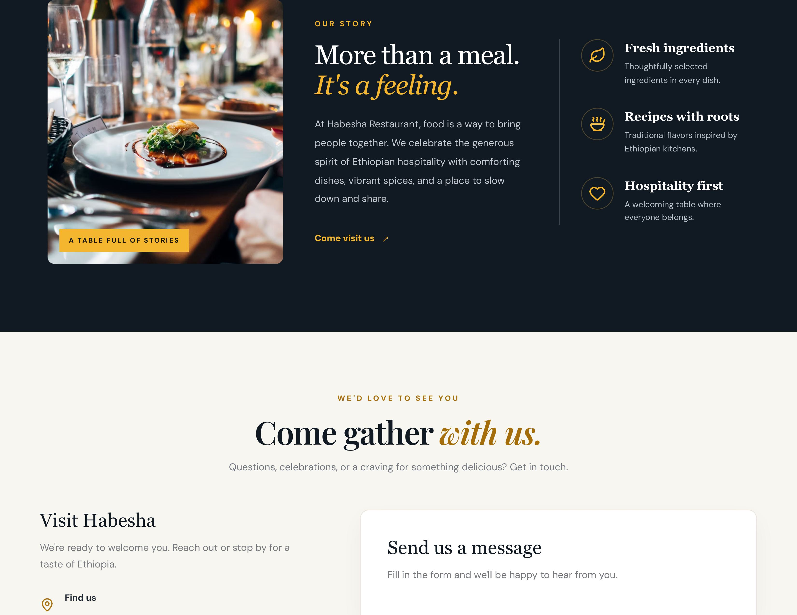
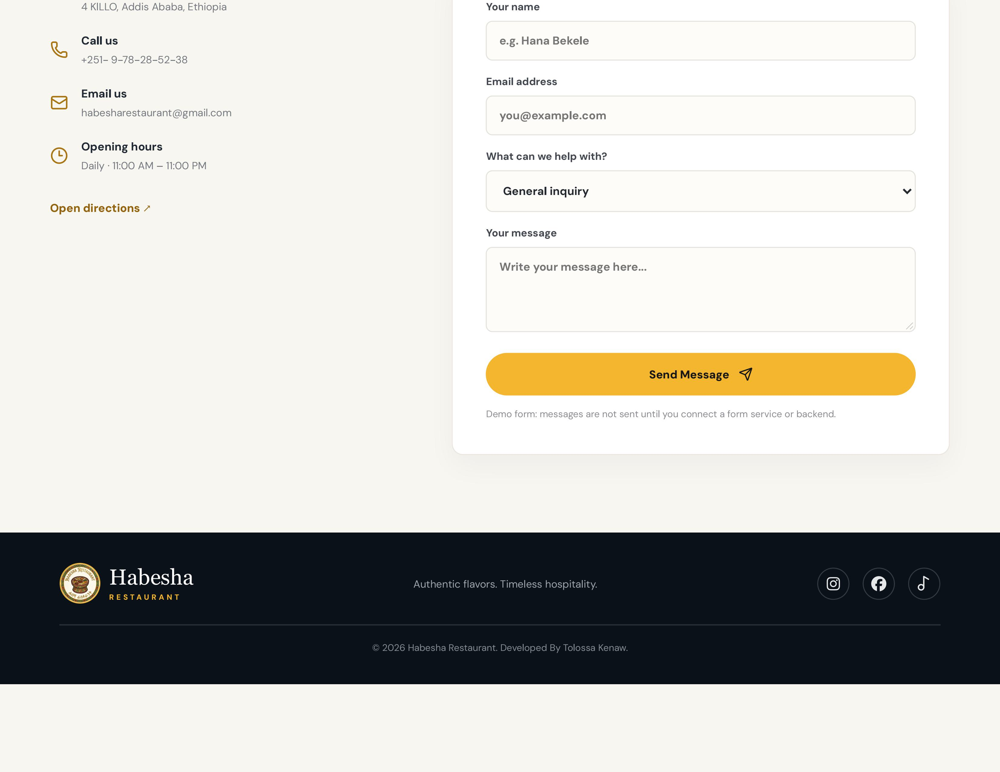
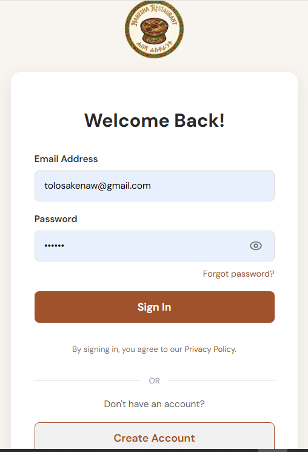
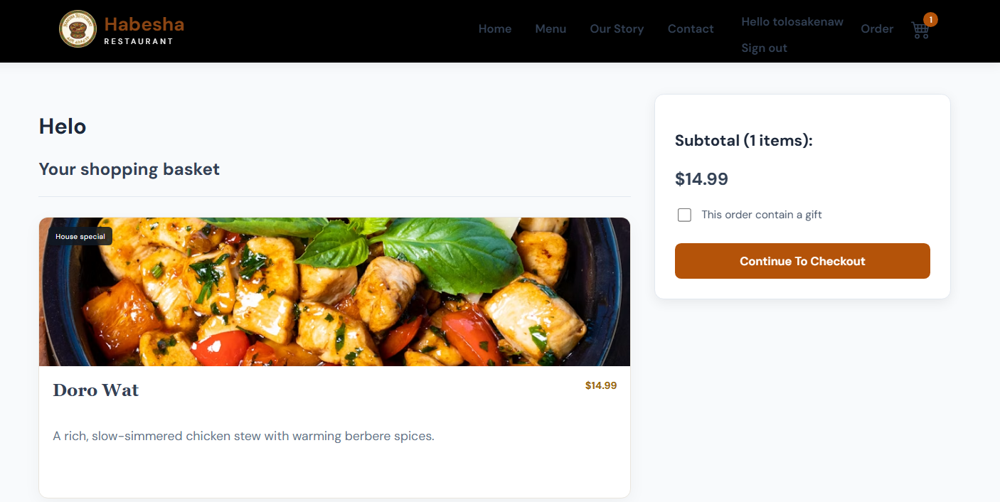
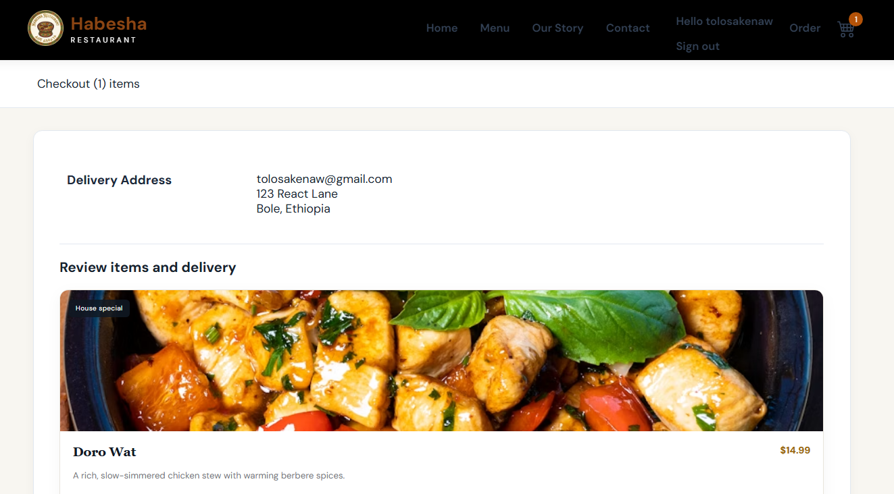
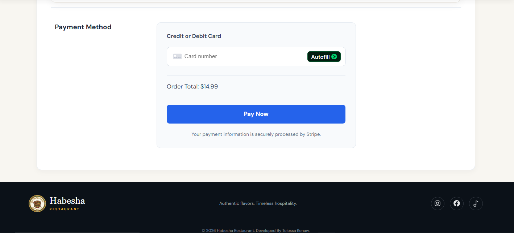

# 🍽️ Habesha Restaurant

Habesha Restaurant is a modern restaurant web application built with React.js. It provides customers with an interactive platform to explore Ethiopian food, browse menu categories, add dishes to their shopping basket, authenticate their accounts, and make online payments securely.
The application integrates Firebase for authentication and database management, Stripe for payment processing, and Render for backend deployment.

## 🎯 Project Objectives
- Develop a real-world restaurant web application.
- Practice React.js component-based development.
- Implement user authentication and database integration.
- Integrate a third-party payment gateway.
- Develop RESTful APIs using Node.js and Express.js.
- Gain practical experience deploying backend applications.

## 🚀 Features
- *Responsive Design*: User-friendly interface compatible with desktop, tablet, and mobile devices.
- Food Menu: Browse different Ethiopian food categories, including vegetarian dishes, meat dishes, snacks, and beverages.
- Shopping Cart: Add food items to the basket and manage orders.
- User Authentication: Register and sign in using Firebase Authentication.
- Database Management: Store and retrieve application data using Firebase Cloud Firestore.
- Online Payment: Integrated Stripe payment gateway for processing payments.
- Backend API: Node.js and Express.js backend for handling server-side operations.
- Order Management: Manage customer orders and payment-related operations.
  
## project design
[Project LINK](https://habeshareataurant.netlify.app/)
 
 
 

## SignIn desin
  
  ## Cart
  
  ## Checkout desin
  
   
## 🛠️ Technologies Used
Frontend
- React.js
- JavaScript (ES6+)
- HTML5
- CSS3
- CSS Modules
- React Router DOM
- Axios
- React Icons
Backend
- Node.js
- Express.js
- REST API
- Render (Backend Deployment)
Database & Authentication
- Firebase Authentication
- Firebase Cloud Firestore

Payment Integration
- Stripe Payment Gateway

Development Tools
- Visual Studio Code
- Git
- GitHub
# 🏗️ Project Architecture
The application follows a frontend-backend architecture:
1. React.js: Handles the user interface and client-side interactions.
2. Firebase Authentication: Manages user registration and login.
3. Cloud Firestore: Stores and retrieves application data.
4. Node.js & Express.js: Handle backend API requests and server-side operations.
5. Stripe: Processes online payment transactions.
6. Render: Hosts and deploys the backend server.
## 💳 Payment Integration
Stripe is integrated to support online payments.
The payment workflow:
1. Customers select food items from the menu.
2. Selected items are added to the shopping cart.
3. Customers proceed to checkout.
4. The frontend communicates with the backend API.
5. The backend securely handles Stripe payment operations.
6. Payment confirmation is processed and the order can be recorded.

## 🔐 Authentication & Database
- Firebase Authentication
- User registration.
- User login.
- Authentication state management.
Firebase Cloud Firestore
- Store application data.
- Retrieve and manage customer-related information.
- Store order information.
## 👨‍💻 Developer

## Tolossa Kenaw
Full-Stack Web Developer | Data Analysis & BI | Database Administration

- GitHub: github.com/tolossa320
- Portfolio: tolossaportifolio.netlify.app
- LinkedIn: linkedin.com/in/tolossa-kenaw
